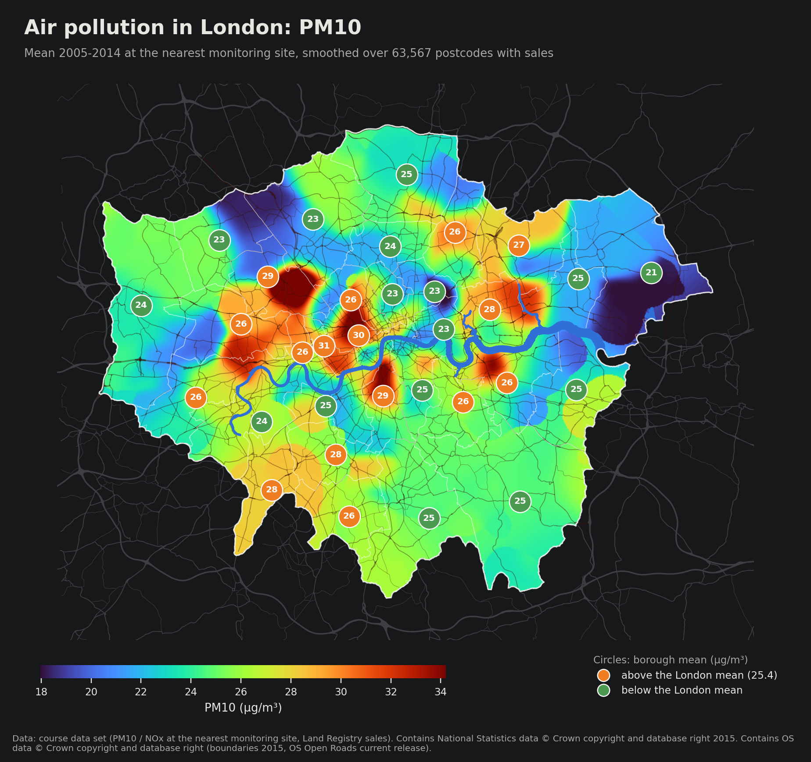
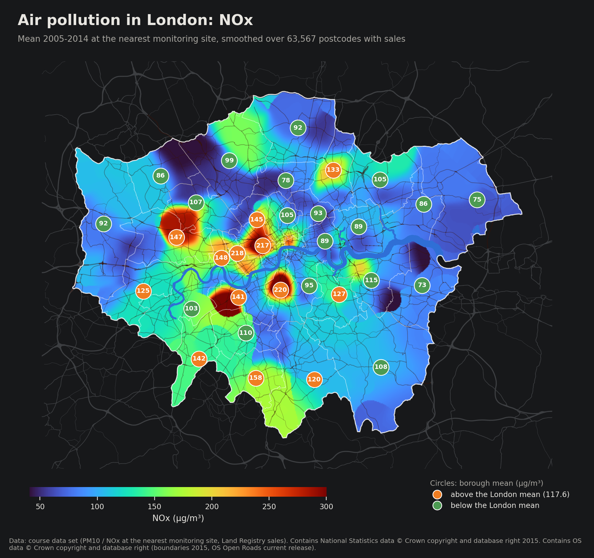
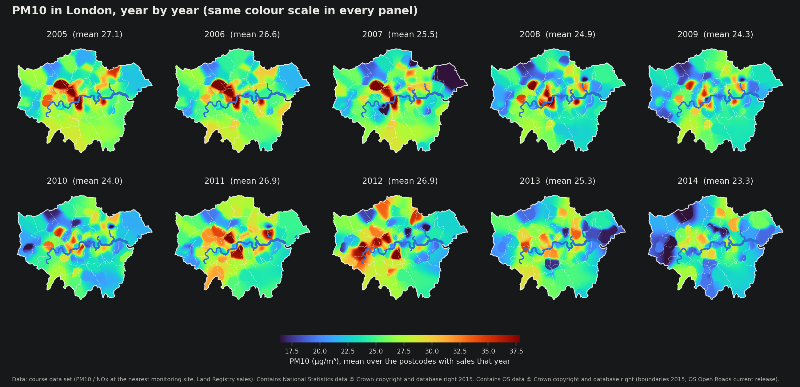

# Air Pollution in London: Heat Maps

Generated by `air_pollution_maps.py` from our own data.

Every map also exists with a white background, for print and for the report: `figures/map_pm10_white.png`,
`figures/map_nox_white.png` and `figures/map_pm10_by_year_white.png`.

## What the maps show

- **Colour:** the yearly mean of PM10 (or NOx) at the monitoring site nearest to each home, as in the course data and
  in all our models. For each of the 63,567 postcodes with a sale we take the mean over 2005-2014 (first
  per year, then over the years, so busy years do not count more), and smooth these values with a Gaussian kernel
  (σ = 750 m on a 100 m grid; where there are almost no postcodes, such as large parks or reservoirs,
  σ = 3 km). Every postcode counts once, so dense areas do not dominate.
- **Circles:** the mean over the postcodes of each borough. Orange: above the London mean, green: below.
- **Roads, Thames and borough lines** are drawn for orientation. The roads are not part of the pollution values.

| Pollutant | London mean (postcodes) | 5th percentile of the map | 95th percentile of the map |
|---|---|---|---|
| PM10 (µg/m³) | 25.4 | 19.5 | 30.3 |
| NOx (µg/m³) | 117.6 | 58.2 | 193.8 |

Mean PM10 over the postcodes with sales, by year: 2005: 27.1 | 2006: 26.6 | 2007: 25.5 | 2008: 24.9 | 2009: 24.3 | 2010: 24.0 | 2011: 26.9 | 2012: 26.9 | 2013: 25.3 | 2014: 23.3.

## What the maps do not show

- **No road-level detail.** Maps such as the London Atmospheric Emissions Inventory (LAEI) model the concentration
  for every 20 m and show the extra pollution along busy roads. Our values come from a few dozen monitoring sites:
  each home gets the value of its nearest site, so the true pattern in our data is a set of areas around the sites,
  which the smoothing blurs into a continuous surface. Local hot spots along main roads are not in the data.
- **Only where homes were sold.** The surface is built from postcodes with at least one sale in 2005-2014.
  Large parks, the airports and industrial areas get the values of the homes around them.

## Sources

- PM10, NOx and the sales: course data set `land_registry_pollution.dta`.
- Borough boundaries (2011, clipped at mean high water; the Thames is the gap between them):
  [Statistical GIS Boundary Files for London](https://data.london.gov.uk/dataset/statistical-gis-boundary-files-london),
  London Datastore, Open Government Licence. Contains National Statistics data © Crown copyright and database right
  2015. Contains Ordnance Survey data © Crown copyright and database right 2015.
- Roads: [OS Open Roads](https://osdatahub.os.uk/downloads/open/OpenRoads) (motorways, A and B roads), current
  release, Open Government Licence. Contains OS data © Crown copyright and database right.
