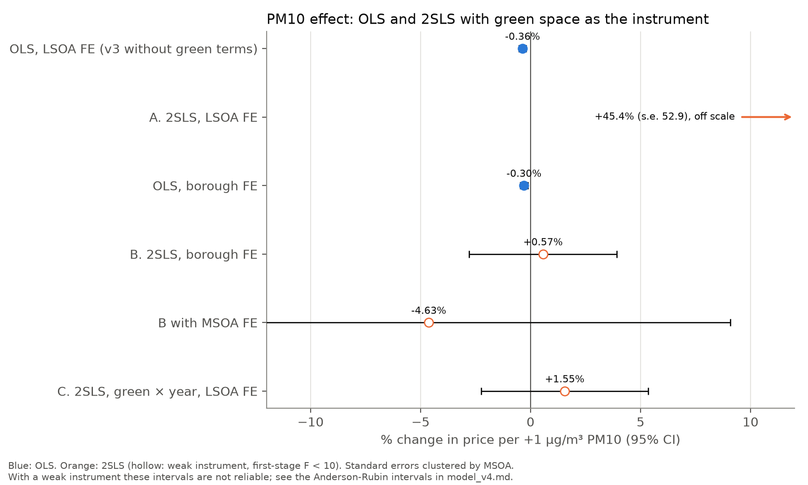

# Model v4: Green Space as an Instrument for PM10

Generated by `model_v4.py`. Outcome: log sale price. Coefficients ×100 give the % change in price per +1 µg/m³
PM10. Sample: the v3 sample (270,399 sales, 2007-2014, 3-year average PM10). Standard errors
clustered by MSOA unless stated otherwise.

## 1. The idea

Our OLS estimates (v1 to v3) can be biased for two reasons:

- **Measurement error.** PM10 is the value of the nearest of about 60 to 74 monitoring sites, not of the home. This
  biases the effect towards zero (attenuation).
- **Omitted variables.** Anything that changes prices and PM10 at the same time and is not in our controls.

An **instrument** is a variable that (1) moves PM10 (**relevance**) and (2) affects prices **only** through PM10
(**exclusion restriction**). Then 2SLS uses only the part of PM10 that the instrument explains:

- **First stage:** PM10 = π · green + controls + fixed effects
- **Second stage:** ln(price) = β · predicted PM10 + controls + fixed effects

The lecturer's suggestion: **green space** (share of land within 500 m of the postcode that is green, OS Open
Greenspace, the same measure as in v3) lowers PM10 because vegetation filters particles, and it raises prices only
because of cleaner air. Equivalent check: the reduced form (price on green) should equal β × π.

The exclusion restriction is a strong assumption. Green space is also an amenity in itself (parks, views,
recreation, quiet), so it can raise prices directly. Section 4 tests this as far as the data allow.

**Model.** The v3 model (27 controls: property type, distances, bus access, census shares, borough economy,
main roads, road noise) with the 3-year average of PM10. The green share and the low-green dummy are **not** in the
model (green space is the instrument), and the interactions PM10 × house and PM10 × low green are left out, so the
2SLS estimates one average PM10 effect. The OLS benchmark uses exactly the same controls.

## 2. Why the v3 setting cannot identify the IV

In v3, PM10 is identified from **changes over time within an LSOA**: PM10 is the same for every sale in an LSOA in a
given year (share of PM10 variance left within LSOA-years: 0.0%), and LSOA and year-quarter fixed effects remove the
level differences between LSOAs and the London-wide trend. Green space does **not** change over time (one current
OS release). After the LSOA fixed effects, green space only differs between postcodes of the same LSOA, and these
postcodes all get the same PM10. So in setting A, green space can explain PM10 only through which years the sales in
an LSOA happen to fall in. The first stage is expected to be zero, and it is
(F = 1.11).

Two settings that can work:

- **B. Between areas (borough fixed effects).** Compares neighbourhoods of the same borough with more and less
  green space. Within boroughs, 70% of the PM10 variance and
  95% of the green variance are left (within LSOAs: 13% and
  26%), so there is variation to use. But this gives up the LSOA fixed
  effects, which the earlier versions showed to be essential: without them the PM10 effect depends heavily on the
  location controls (`model_v1.md`).
- **C. Green space × year.** Keeps the LSOA fixed effects and asks whether greener places saw different PM10
  **changes** over 2007-2014. The green share stays in the model as a control, so green space may raise prices
  directly; only its effect on price **changes** is excluded. This is a weaker (more believable) exclusion
  restriction, but it needs green space to change the PM10 **trend**, which the vegetation story does not predict.

## 3. Results

| Setting | First stage: green → PM10 (µg/m³ per +10 pp green) | First-stage F | Reduced form: green → price (% per +10 pp) | **2SLS PM10 effect** | Anderson-Rubin 95% interval | OLS, same FE |
|---|---|---|---|---|---|---|
| A. v3 setting: LSOA FE, green share | +0.0147 (0.0140) | 1.1 (weak) | +0.667 (0.475) | +45.372 (52.932) | unbounded | -0.363 (0.083) |
| B. Between areas: borough FE, green share | -0.2358 (0.0996) | 5.6 (weak) | -0.134 (0.407) | +0.568 (1.710) | -5.31% to +6.63% | -0.298 (0.089) |
| B with MSOA FE | -0.0757 (0.0565) | 1.8 (weak) | +0.350 (0.430) | -4.629 (6.994) | unbounded |  |
| B with borough clusters | -0.2358 (0.1196) | 3.9 (weak) | -0.134 (0.375) | +0.568 (1.708) | above -2.89% (unbounded) |  |
| C. Green × year: LSOA FE, green share as a control | 7 coefficients, joint p 0.111 | 1.7 (weak) | joint p 0.589 | +1.552 (1.940) | unbounded | -0.364 (0.083) |

PM10 effects in % per µg/m³ (standard error); first stage in µg/m³ PM10 per +10 percentage points of green
space. F: clustered Wald F statistic of the excluded instrument(s); below 10 the instrument is weak and the
2SLS estimate and its standard error are not reliable. The Anderson-Rubin interval is valid even with a weak
instrument: it contains every PM10 effect that the data cannot reject at 5%. Values between
-20.00% and +20.00% were tried.

**Setting C, first stage by year** (PM10 change in µg/m³ per +10 pp green space, relative to 2007):

| Year | Green × year |
|---|---|
| 2008 | -0.0180 (0.0480) |
| 2009 | -0.0320 (0.0711) |
| 2010 | +0.0808 (0.0938) |
| 2011 | +0.0966 (0.0965) |
| 2012 | +0.0807 (0.1092) |
| 2013 | -0.0525 (0.1273) |
| 2014 | +0.0393 (0.1078) |

Hansen J test of over-identification (do the 7 instruments agree?): J = 4.70, df 6,
p 0.583.

## 4. Is the exclusion restriction plausible?

**Check 1: does green space still move prices when PM10 is held fixed?** If green space affected prices only
through PM10, its coefficient should be zero once PM10 is in the regression.

| Fixed effects | Green share (per +10 pp), PM10 held fixed | |
|---|---|---|
| Borough | -0.20% (s.e. 0.410 pp) | not significant |
| LSOA | +0.67% (s.e. 0.475 pp) | not significant |

**Check 2: is green space as good as random?** An instrument should not be related to the other determinants of
prices. The "price index" is the price predicted by the 27 controls alone (OLS without PM10 and without fixed
effects). If green space predicts it, greener and less green places differ in other ways too.

| Fixed effects | Price index on green share (% per +10 pp) | |
|---|---|---|
| Borough | +0.67% (s.e. 0.632 pp) | not significant |
| LSOA | +1.54% (s.e. 0.571 pp) | significant at 1% |

Single controls on the green share (borough FE, per +10 pp green):

| Control | Coefficient (s.e.) | | Size |
|---|---|---|---|
| log distance to centre | +0.0139 (0.0057) | significant at 5% | 2.4% of a s.d. |
| share without qualifications | +0.0044 (0.0017) | significant at 1% | 5.2% of a s.d. |
| within 50 m of a main road | -0.0062 (0.0048) | not significant | 1.8% of a s.d. |
| house (not a flat) | +0.0309 (0.0075) | significant at 1% | 6.2% of a s.d. |

## 5. Verdict

- **Relevance fails: green space is a weak instrument in every setting.** No setting reaches a first-stage F of
  10 (highest: 5.6, setting B). With LSOA fixed effects (A) this is by construction (section 2).
  Between neighbourhoods of the same borough (B), greener places do have slightly lower PM10, with the expected sign
  (-0.236 µg/m³ per +10 pp green space, 0.9% of mean PM10), but this is
  far too little to predict PM10 reliably. Green space also did not change the PM10 **trend** (C: joint p
  0.111).
- **So the 2SLS estimates say nothing about the PM10 effect.** They jump between -4.63% and
  +45.37% per µg/m³ with huge standard errors. The Anderson-Rubin intervals, which stay valid
  with a weak instrument, are unbounded (A, C) or run from -5.31% to +6.63% (B): they contain both zero and our OLS estimate
  (-0.36%). The IV can neither confirm nor reject the v3 result.
- **The exclusion restriction cannot be confirmed either.** With PM10 held fixed, green space has no significant
  direct price effect (check 1), but the estimates are imprecise. Greener postcodes differ in other ways: they are
  further from the centre, have more houses and more residents without qualifications, and within LSOAs the price
  predicted by the controls rises with green space (+1.54% per +10 pp, significant at 1%).
  If they differ in observed price determinants, they probably differ in unobserved ones too.
- **Why it does not work here.** Our PM10 is measured at monitoring sites, often kilometres away, and green space
  is measured within 500 m and does not change over time. The mechanism (vegetation filtering particles locally)
  operates at a scale our PM10 measure cannot see.
- **Consequence for the report.** v3 stays the main model. v4 is a documented robustness attempt: the
  lecturer's instrument was tested and is too weak with our data, so it cannot be used to give the PM10 effect a
  causal interpretation. A working IV would need PM10 modelled at the address (e.g. LAEI) or a source of PM10 change
  that differs between areas and is unrelated to other price drivers.

## Limitations

- **Scale.** Green space is measured within 500 m of the postcode, PM10 at the nearest monitoring site, often
  several kilometres away. Vegetation near a home cannot change the reading of a distant monitor, so even if green
  space does clean the air locally, our PM10 measure cannot show it. A modelled PM10 surface (e.g. the London
  Atmospheric Emissions Inventory, LAEI, at 20 m resolution) would be needed for a real test of the mechanism.
- **Green space is fixed in time** (current OS release), which is why it cannot be used with LSOA fixed effects.
- **One instrument, one endogenous variable.** The interactions of v3 (PM10 × house, PM10 × low green) are not
  instrumented here.
