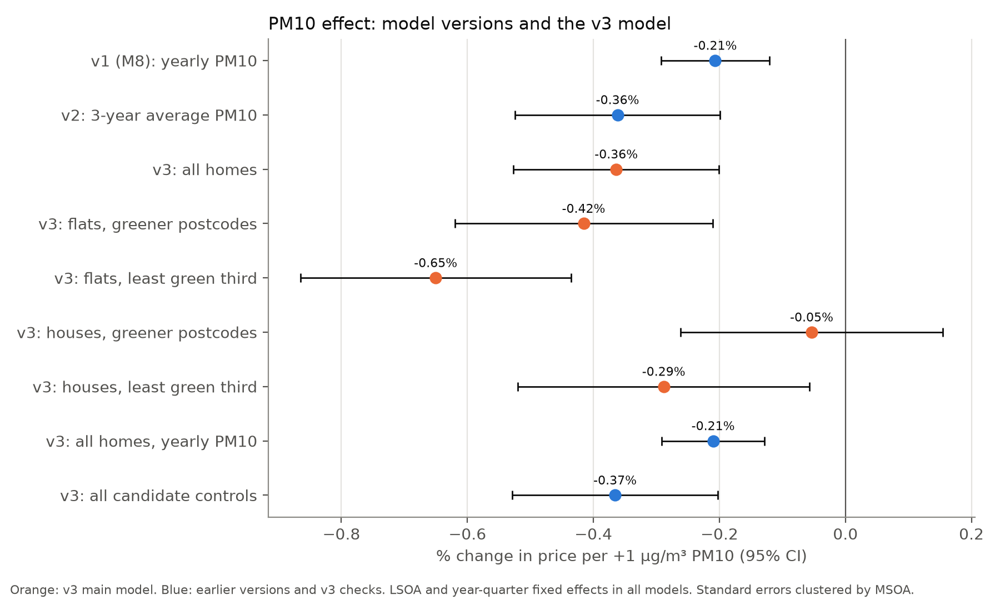

# Model v3: The Complete Final Model

Generated by `model_v3.py`. The audit and all model results are produced by the script; the results of earlier
tests in the inventory are quoted from the files named there. Outcome: log sale price. Coefficients ×100 give the
% change in price.

## 1. Everything we controlled for or tested

| What | Where | Result | In v3? |
|---|---|---|---|
| **PM10, yearly** at the nearest monitoring site | `model_v1.md` | -0.21% per µg/m³ in M8 | Robustness check |
| **PM10, 3-year average** (t-2 to t) | `model_v1_pm10_smoothing.md` | Larger effect (-0.37%): yearly swings are measurement error | **Yes, main PM10 measure** |
| PM10, last year / 2SLS with last year as instrument | `model_v1_pm10_smoothing.md` | -0.20% / -0.52% | No (check only) |
| Property type, new build, tenure | `model_v1.md` | Large and significant; vary within LSOAs | **Yes** |
| Distance to centre and to the tube | `model_v1.md`, `model_v1_non-linear.md` | Key controls *without* area fixed effects (they turn the PM10 sign); mostly absorbed by LSOA FE but still improve the fit | **Yes** (log + log², see audit) |
| Distance to bus stop, bus stops within 200 m | `model_v1.md` | Vary within LSOAs | **Yes** (linear) |
| Distance to a Grade I park, to the Thames | `model_v1.md` | Mostly absorbed by LSOA FE; the Thames term picks up a riverside premium | **Yes** (with the other distances) |
| Grade I heritage buildings within 200 m | `model_v1.md` | No effect within LSOAs (audit) | No |
| Non-linear distances (log + log²) | `model_v1_non-linear.md` | Lowest BIC in every fixed-effects level; PM10 unchanged | **Yes** |
| Borough pay, job density, unemployment, population (by year) | `model_v1.md`, `model_v1_income_groups.md` | Change over time, so they can confound the PM10 changes; job density moved PM10 a lot in v1 | **Yes** (pay as a cubic) |
| Census shares: no qualifications, minorities, lone parents | `model_v1.md` | Output-area level, so they vary within LSOAs | **Yes** |
| NOx | `model_v1.md` | No effect once PM10 is in | No |
| Crime | `model_v1.md` | No effect; only 2010-2014 | No |
| Year-quarter fixed effects | `model_v1.md` | Remove the London-wide price trend | **Yes** |
| LSOA fixed effects | `model_v1.md` | Compare sales within small neighbourhoods | **Yes** |
| Borough-by-year / LSOA-by-year fixed effects | `model_v1.md`, `model_v2.md` | Strict checks | Robustness check |
| Income (LSOA, MSOA, borough) × PM10 | `model_v1_income_groups.md`, `model_v1_income_small_area.md` | No income gradient | No |
| PM10 × house | `model_v2.md`, `model_v2_roads.md` | **Robust**: flats carry the larger discount, also with LSOA-by-year FE | **Yes, interaction** |
| PM10² | `model_v2.md` | No non-linearity | No |
| PM10 × share aged 0-15 / 65+ | `model_v2.md` | No robust effect | No |
| PM10 × education | `model_v2.md` | Weak hint, not robust | No |
| Distance to a main road (OS Open Roads) | `model_v2_roads.md` | -2.0% to -2.5% within 50 m; nothing beyond | **Yes** (within 50 m) |
| Road noise (Defra 2012) | `model_v2_roads.md` | About -2.3% at 65-74.9 dB; nothing below 65 dB | **Yes** (65-74.9 dB, 75 dB+) |
| PM10 × near a main road / × noise | `model_v2_roads.md` | No effect | No |
| Green share within 500 m (OS Open Greenspace) | `model_v1_green_space.md` | +0.81% per +10 pp within LSOAs (10% level); not significant in the audit | **Yes**, as a main effect of the green interaction |
| PM10 × green space | `model_v1_green_space.md`, this file | Larger discount where there is almost no green space; in v1 not robust to LSOA-by-year FE, in v3 robust | **Yes, interaction** (least green third) |
| Local park within 400 m, × PM10 | `model_v1_green_space.md` | No effect | No |
| Energy efficiency (EPC), × PM10 | `model_v1_energy_efficiency.md` | Hypothesis not supported; the postcode score mixes building age and type; only 76% of sales matched | No |

## 2. Which controls does the final model need? (audit)

Start: the v2 controls plus all road bands, all noise bands and the green share, with the 3-year average of PM10,
LSOA and year-quarter fixed effects (270,399 sales). PM10 effect in this model: -0.37%
(s.e. 0.083 pp). Each block is then dropped once.

| Block | Terms | Variance left within LSOAs | Joint test χ² | p | PM10 effect without the block | Shift (s.e.) | ΔBIC without the block | v3 |
|---|---|---|---|---|---|---|---|---|
| Property type, new build, tenure | 5 | 67.4% | 7542.2 | < 0.001 | -0.30% | +0.78 | +135,733 | **kept** |
| Distance to centre, tube, Grade I park, Thames (log + log²) | 8 | 5.0% | 97.7 | < 0.001 | -0.35% | +0.13 | +2,305 | **kept** |
| Bus stop distance (log + log²) and bus stops within 200 m | 3 | 61.8% | 23.2 | < 0.001 | -0.36% | +0.01 | +134 | **kept, linear** |
| Grade I heritage buildings within 200 m | 1 | 46.8% | 0.0 | 0.992 | -0.37% | +0.00 | -13 | dropped |
| Census shares: no qualifications, minorities, lone parents | 3 | 27.3% | 390.3 | < 0.001 | -0.38% | -0.14 | +6,116 | **kept** |
| Borough economy by year: pay (cubic), job density, unemployment, population | 6 | 9.8% | 137.1 | < 0.001 | -0.50% | -1.59 | +1,101 | **kept** |
| Distance to a main road, 4 bands (OS Open Roads) | 4 | 74.6% | 15.6 | 0.004 | -0.37% | +0.01 | +90 | **kept, simplified** |
| Road noise, 5 bands (Defra 2012) | 5 | 73.3% | 14.3 | 0.014 | -0.36% | +0.04 | +246 | **kept, simplified** |
| Green share within 500 m (OS Open Greenspace) | 1 | 25.8% | 2.4 | 0.125 | -0.36% | +0.01 | +27 | dropped as a control; main effect of the green interaction |

"Variance left within LSOAs": share of the variable's variance that remains after removing LSOA means; with LSOA
fixed effects, only this part is used. ΔBIC > 0 means the fit gets worse without the block. "Shift (s.e.)": change
of the PM10 effect in standard errors of the full model.

**Rule.** A block stays if it is jointly significant at 5% (clustered Wald test) **or** if dropping it
moves the PM10 effect by 0.5 standard errors or more. A kept block is then simplified to the terms that
matter.

- **Not needed: Grade I heritage buildings within 200 m.**
  Grade I heritage buildings within 200 m: p 0.992, PM10 shift +0.00 s.e.
- **Green share: not needed as a control, but part of the green interaction.** On its own it raises prices only a
  little within LSOAs (+0.72% per +10 pp, p 0.125). It returns in v3 as a
  main effect of PM10 × low green (section 3), together with the low-green dummy.
- **Needed because it changes the PM10 effect: the borough economy.** It changes over time like PM10; without it
  the effect would be -0.50% instead of -0.37% (-1.59 s.e.). Property type also
  moves it (+0.78 s.e.).
- **Needed because they explain prices within LSOAs:** bus access, census shares, main roads, road noise. They
  hardly move the PM10 effect (PM10 is identified from changes over time, these are fixed), but they are real price
  determinants and improve precision. The census shares also protect the road and noise estimates against poorer
  streets being nearer main roads.
- **Distances to the centre, tube, Grade I park and Thames** keep only 5.0% of their variance
  within LSOAs, yet they are jointly significant (χ² = 97.7) and the fit is worse without them
  (ΔBIC +2,305; mostly the riverside premium in the Thames term, `model_v1_non-linear.md`). They stay,
  in log + log² form; their coefficients should not be interpreted.
- **Simplified.** Only homes within 50 m of a main road and noise of 65 dB or more are discounted; the other bands
  (50-400 m, 55-64.9 dB) are jointly zero (χ² = 7.1, df 5, p 0.217), so v3 keeps three
  dummies. Bus distance enters linearly (its log-quadratic form added nothing, `model_v1_non-linear.md`).

## 3. The v3 model

ln(price) = β · PM10₃ + θ₁ · PM10₃ × house + θ₂ · PM10₃ × low green + property + distances + bus access
+ census shares + borough economy + main road + road noise + green share + low green + LSOA FE
+ year-quarter FE + error

PM10₃ = mean PM10 of the sale year and the two years before. "Low green" = the least green third of postcodes
(below 3.8% green space within 500 m). The green share and the low-green dummy enter as main
effects, so that PM10 × low green compares how prices react to the same change in PM10, not price levels.
Standard errors clustered by MSOA. Sample: 270,399 sales, 2007-2014 (0 sales without road or green
values).

### Headline

- **PM10 effect, all homes: -0.36% per µg/m³** (s.e. 0.083 pp), about
  **£1,292 per home** for 1 µg/m³ less PM10 at the mean price (£355,180).
  Elasticity at mean PM10: -0.093.
- **PM10 × house: +0.362 pp (significant at 1%, p 0.001)**: houses lose less value from PM10 than flats.
- **PM10 × low green: -0.235 pp (significant at 1%, p 0.007)**: homes with almost no green space nearby lose more.
- **Additional data:** within 50 m of a main road -2.5%, road noise 65-74.9 dB
  -2.5%, 75 dB or more -22.3% (few sales); green
  space enters through the interaction.

**PM10 effect by group** (from the main model):

| Group | PM10 effect | Std. error (pp) | WTP per µg/m³ | Mean price | Sales |
|---|---|---|---|---|---|
| Flats, greener postcodes | -0.42%*** | 0.104 | £1,319 | £317,347 | 89,082 |
| Flats, least green third | -0.65%*** | 0.110 | £2,098 | £322,547 | 52,712 |
| Houses, greener postcodes | -0.05% | 0.106 | £209 | £390,737 | 91,559 |
| Houses, least green third | -0.29%** | 0.118 | £1,167 | £404,706 | 37,046 |

WTP = −effect × mean price of the group.

### Full coefficient table

| Variable | v3, average PM10 effect | **v3 (main)** | v3, yearly PM10 |
|---|---|---|---|
| PM10, 3-year average (µg/m³) | -0.00364*** (0.00083) | -0.00416*** (0.00104) | -0.00221*** (0.00060) |
| PM10 × house |  | +0.00362*** (0.00112) | +0.00162** (0.00079) |
| PM10 × low green (least green third) |  | -0.00235*** (0.00088) | -0.00169*** (0.00058) |
| Detached house (base: flat) | +0.55466*** (0.01384) | +0.46330*** (0.03066) | +0.51246*** (0.02314) |
| Semi-detached house | +0.26925*** (0.00965) | +0.17721*** (0.02999) | +0.22004*** (0.02201) |
| Terraced house | +0.15511*** (0.00885) | +0.06138** (0.03041) | +0.10751*** (0.02231) |
| New build | +0.13974*** (0.01032) | +0.13880*** (0.01031) | +0.15669*** (0.00758) |
| Freehold (base: leasehold) | +0.34348*** (0.00989) | +0.34448*** (0.00984) | +0.34427*** (0.00840) |
| log distance to centre | -0.78650*** (0.16967) | -0.79216*** (0.16940) | -0.64884*** (0.18951) |
| log distance to centre² | +0.17300*** (0.05914) | +0.17196*** (0.05955) | +0.14043** (0.06041) |
| log distance to tube | -0.04328** (0.01946) | -0.04261** (0.01943) | -0.03838** (0.01835) |
| log distance to tube² | -0.02136*** (0.00772) | -0.02093*** (0.00770) | -0.01768** (0.00798) |
| log distance to Grade I park | -0.07391** (0.03726) | -0.06955* (0.03759) | -0.06621* (0.03393) |
| log distance to Grade I park² | -0.00534 (0.00751) | -0.00479 (0.00753) | -0.00360 (0.00681) |
| log distance to Thames | -0.01090 (0.03388) | -0.01195 (0.03387) | -0.00784 (0.03093) |
| log distance to Thames² | +0.02332*** (0.00732) | +0.02304*** (0.00732) | +0.02251*** (0.00706) |
| Distance to nearest bus stop (km) | +0.11149*** (0.02441) | +0.11205*** (0.02442) | +0.09224*** (0.02153) |
| Bus stops within 200 m | +0.00158 (0.00155) | +0.00153 (0.00153) | +0.00072 (0.00135) |
| Share without qualifications (0-1) | -0.57624*** (0.04581) | -0.57849*** (0.04568) | -0.44956*** (0.04029) |
| Share ethnic minorities (0-1) | -0.26139*** (0.03038) | -0.26170*** (0.03037) | -0.27875*** (0.02830) |
| Share lone-parent households (0-1) | -0.36725*** (0.04793) | -0.36713*** (0.04782) | -0.29033*** (0.05028) |
| Borough pay, centred (£1,000) | -0.00043 (0.00154) | -0.00061 (0.00155) | +0.00346*** (0.00126) |
| Borough pay² | +0.00137*** (0.00027) | +0.00137*** (0.00027) | +0.00149*** (0.00017) |
| Borough pay³ | -0.00004*** (0.00001) | -0.00004*** (0.00002) | -0.00005*** (0.00001) |
| Borough job density | +0.19839*** (0.04609) | +0.18763*** (0.04600) | +0.26339*** (0.03818) |
| Borough unemployment rate (%) | -0.01019*** (0.00169) | -0.01032*** (0.00170) | -0.01212*** (0.00149) |
| Borough population (1,000) | -0.00077 (0.00054) | -0.00075 (0.00054) | -0.00126*** (0.00045) |
| Within 50 m of a motorway or A road | -0.02492*** (0.00695) | -0.02532*** (0.00694) | -0.02203*** (0.00639) |
| Road noise 65-74.9 dB (base: below 65 dB) | -0.02584** (0.01095) | -0.02503** (0.01091) | -0.02394** (0.00998) |
| Road noise 75 dB or more | -0.24520** (0.09794) | -0.25180*** (0.09606) | -0.21439** (0.09089) |
| Low green: least green third of postcodes | +0.01016* (0.00599) | +0.06979*** (0.02275) | +0.05429*** (0.01546) |
| Green share within 500 m (per +10 pp, centred) | +0.00920* (0.00526) | +0.00946* (0.00527) | +0.01250*** (0.00472) |
| Year-quarter FE | Yes | Yes | Yes |
| LSOA FE | Yes | Yes | Yes |
| Sales | 270,399 | 270,399 | 425,807 |
| R² | 0.726 | 0.727 | 0.725 |

Coefficients (standard errors clustered by MSOA). \* p < 0.10, \*\* p < 0.05, \*\*\* p < 0.01. In the main
model the `pm10` row is the effect for flats in greener postcodes. The distances keep little variation within
LSOAs, the census shares hardly vary within LSOAs and the borough terms are controls for time-varying confounders;
their coefficients should not be interpreted.

### Robustness

| Specification | PM10 (flats, greener) | PM10 × house | PM10 × low green | Sales |
|---|---|---|---|---|
| **v3 (main)** | -0.416*** (0.104) | +0.362*** (0.112) | -0.235*** (0.088) | 270,399 |
| Yearly PM10 (longer sample, 2005-2014) | -0.221*** (0.060) | +0.162** (0.079) | -0.169*** (0.058) | 425,807 |
| All candidate controls (incl. all road and noise bands, heritage) | -0.419*** (0.104) | +0.364*** (0.112) | -0.230*** (0.086) | 270,399 |
| Without main roads and road noise | -0.403*** (0.104) | +0.342*** (0.112) | -0.245*** (0.088) | 270,399 |
| Only PM10 × house (no green terms) | -0.492*** (0.098) | +0.365*** (0.113) |  | 270,399 |
| Only PM10 × low green | -0.284*** (0.092) |  | -0.245*** (0.088) | 270,399 |
| + borough-by-year fixed effects | -0.157* (0.094) | +0.373*** (0.116) | -0.209** (0.089) | 270,399 |
| LSOA-by-year fixed effects | absorbed | +0.385*** (0.120) | -0.280** (0.113) | 270,399 |
| Standard errors clustered by borough | -0.416** (0.177) | +0.362** (0.172) | -0.235** (0.092) | 270,399 |

Coefficient ×100 (standard error ×100). Empty cell: term not in that specification. LSOA-by-year fixed effects
compare homes sold in the same LSOA in the same year; PM10 itself is absorbed, both interactions are still
identified.

- **PM10 × house** keeps its sign and is significant at 5% in 8 of 8 specifications.
- **PM10 × low green** keeps its sign and is significant at 5% in 8 of 8 specifications.
- The two interactions hardly affect each other: compare the two "Only ..." rows with the main row.

**A caution on PM10 × low green.** About 12 PM10 interactions were tested across the project. With a
Bonferroni correction for that many tests (p < 0.0042), PM10 × house
passes (p 0.001) and PM10 × low green
does not pass (p 0.007). The low-green
cut (least green third) was also chosen after seeing the tercile results in `model_v1_green_space.md`, where the
interaction failed with LSOA-by-year fixed effects (yearly PM10, v1 controls). It is robust within this model, but
it should be presented as the less certain of the two interactions.

## 4. Verdict

- **The PM10 effect hardly depends on the choice of controls, except one block.** With all candidate controls it
  is -0.37%; v3 gives -0.36% for all homes. Only the borough economy moves it noticeably (without it
  -0.50%), which is why it stays. What matters most for its size is the PM10 measure (3-year
  average vs yearly: -0.36% vs -0.21%).
- **Borough-by-year fixed effects.** In v1 these took the PM10 effect to zero; in v3 the effect for flats in
  greener postcodes is -0.16% (significant at 10%), and both interactions stay
  significant.
- **The discount is concentrated in flats and in places with little green space.** The PM10 effect is
  -0.65% per µg/m³ for flats in the least green third and -0.05% for houses in greener
  postcodes. Both interactions hold with
  LSOA-by-year fixed effects (house +0.385 pp (significant at 1%, p 0.001); low green -0.280 pp (significant at 5%, p 0.013)).
- **The additional data matter.** Main roads and noise shift prices between postcodes of the same LSOA; green
  space changes how much PM10 matters.
- **What we leave out and why:** heritage (no effect within LSOAs), NOx and crime (no effect), PM10² and PM10 ×
  income / age / education / roads / noise / efficiency (no robust effect), energy efficiency (not the home's own
  rating, 24% of sales lost).

## Limitations

- **PM10 from monitoring sites.** The 3-year average reduces measurement error but PM10 is still the value at the
  nearest of about 60 to 74 sites, so the estimate is probably still biased towards zero.
- **Postcode centroids.** Roads, noise and green space are measured from the postcode centre, not the home.
- **Data years.** Roads and green space are current releases and noise is from 2012, while the sales run
  from 2007 to 2014.
- **Not causal.** v3 is the best-controlled association we can estimate with these data; a causal willingness
  to pay would need a quasi-experiment, such as a policy that changed pollution in some areas but not others.
